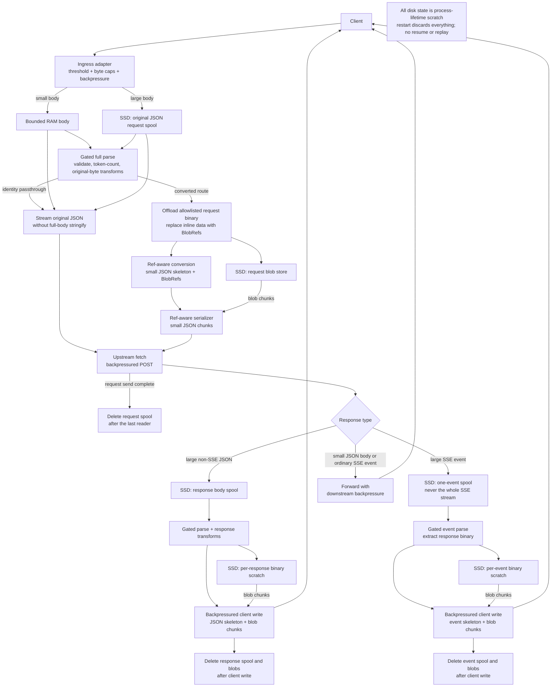
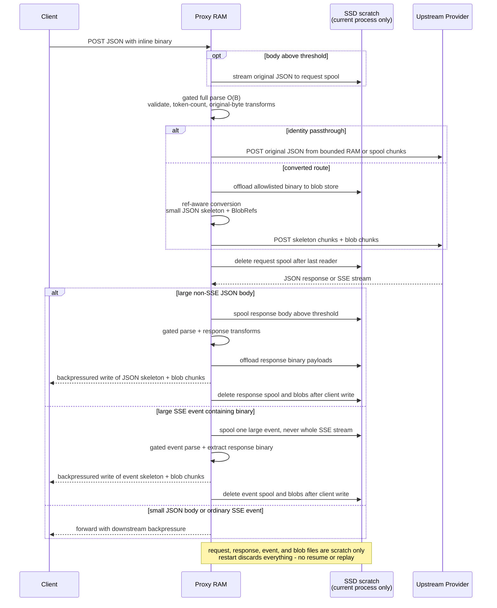

# Plan: SSD spool for large JSON request and response bodies

Status: **Draft** — design only, nothing implemented
Date: 2026-11-02
Scope: Reduce resident memory for slow, in-flight exchanges with large JSON
bodies — especially documented inline base64 images, audio, video, documents,
files, and skill bundles — by spooling requests, finite JSON responses, and
individual SSE events to disk and streaming them at egress. The goal is that
"in flight" stops implying "the full body/event is in memory" for every slow
leg. Touches the Node HTTP adapter (`src/server.ts`), the routing ladder's body
handling (`src/index.ts`), upstream `fetch` call sites, and response/SSE
converters.

**Scope boundary:** ingress spooling is content-agnostic. Ref-based extraction
covers the explicit, schema-qualified inline-binary positions in §9.3 and the
response positions in §5.7, including non-image binary payloads. Large text
and unknown/base64-looking fields outside those allowlists still get the
slow-upload/download benefit, but their parsed and serialized forms remain
O(body/event size). No generic long-string or base64 detection is allowed.

**Storage lifetime:** all disk state is scratch space for the current proxy
process, not a persistent request or response store. A process/system restart
aborts every in-flight upload, upstream send, and downstream response. Old
request/response/event spills and blob entries are never read, resumed,
replayed, or reused after restart; they are only deleted by safe stale-file
cleanup. There is no WAL, manifest, recovery log, or resumable protocol.

**Decisions recorded 2026-11-02 (§9):** spooling is **opt-in, off by default**
(9.1); the Phase 3 lexical scanner is **deferred pending Phase 2 measurements**
(9.2); refs are **restricted to explicit inline-binary positions** (9.3);
Phase 0 does **not** ship ahead of Phases 1–2 — all memory work lands as one
reviewable change; response spooling is **per JSON body or SSE event, with
backpressure, never whole-stream accumulation** (9.5).

Accepted consequence: the current multi-copy peak (§2) stays in production
until that single change lands.

Related: [Proxy Implementation](./proxy_impementation.md),
[Passthrough Mode](./design_passthrough_mode.md),
[Request Transform Hooks](./design_request_transform_hooks.md),
[Sidecar Status](./status_of_sidecars_of_proxy.md) (the `image_encode` sidecar
that already produces these base64 blobs, `src/utils/image-fetch.ts`),
[Dashboard/TUI/Agent Overhead](./dashboard_tui_agent_routing_overhead.md)
(the existing "what sits in the hot path" analysis).

---

## 1. The claim

The problem is not just the allocation peak. It is **live request/response
body state kept reachable while someone else is slow** — the client uploading,
the upstream reading the request, or the client reading a response/SSE stream.
Spooling and ref-based streaming are worth doing because they sever those
links for supported paths: resident memory then depends on bounded stream
buffers, gated parse concurrency, and small per-exchange metadata rather than
on minutes of peer latency.

Four consequences worth stating up front:

1. **The offload is not circular.** On many Linux systems `/tmp` is tmpfs.
   Spool to `os.tmpdir()` and the "offload" can silently stay in RAM. §5.6.
2. **Spooling cannot eliminate the full-parse transient.** `JSON.parse` and
   the current converters still need O(body/event size) live state. A shared
   parse semaphore bounds how many such transients coexist; it does not bound
   how much parsed state each exchange retains afterward. §4.
3. **SSE has two different memory problems.** Some response converters retain
   the parsed request for token counting after `fetch` returns headers, and
   response queues/events can buffer output when the downstream client is
   slow. Request-body offload alone fixes neither; §5.3 and §5.7 address them
   separately.
4. **"Spill" and "cache" describe different objects.** Request, response, and
   per-event spills are temporary and deleted after their last reader. The
   request blob store behind the refs (§5.4) is a genuine two-tier RAM + SSD
   cache with cross-request hits; response blobs are per-response scratch by
   default. The cache's L1 bytes count against the process memory budget.

---

## 2. Where the bytes are today

Measured by reading the code paths, not profiled. `B` = request-body size on
the wire. A 5 MiB binary image becomes about 6.7 MiB of base64 before the
surrounding JSON. JavaScript string representation, V8 copies, external
buffers, and object overhead vary, so `B` is an order-of-memory unit, not an
exact heap multiplier.

| # | Site | Live state and lifetime |
|---|---|---|
| 1 | `src/server.ts:79-87` — inbound `req` wrapped in a `ReadableStream` whose `data` handler enqueues unconditionally | With no consumer backpressure, queued upload chunks can grow toward **O(B)**. |
| 2 | `src/index.ts:1178-1212` — the existing 10 MiB request cap reads all chunks, allocates a combined `Uint8Array`, and rebuilds the `Request` | The cap exists, but its implementation buffers the body. Chunks, the combined buffer, and request representations can coexist during ingestion; the rebuilt body remains available for later reads. |
| 3 | `src/index.ts:1372-1377` — `await request.text()` then `JSON.parse(bodyText)` | Text plus parsed value are **O(B)** during parse; the parsed value remains reachable as `routeBody` for routing and retries. |
| 4 | Handler reads such as `src/handlers/chat-completions.ts:38-43` and `src/handlers/responses.ts:76` | The rebuilt request is read and parsed again. Handler text/objects can coexist with `routeBody` and converted objects. |
| 5 | `src/index.ts:2240-2260` — `clone().text()`, parse, and `JSON.stringify` for a transformed ladder rung | Another **O(B)** transient per transformed rung. Replacing this with a shared mutable object would be wrong unless rung isolation is intentionally changed. |
| 6 | Upstream handler conversions and `body: JSON.stringify(...)` at `fetch` call sites | Original objects, converted objects, and the serialized string can coexist. The serialized body is retained for the upstream send. |
| 7 | `src/utils/logger.ts:82` — object bodies are stringified before `logger.trace` gates on level | Another full string for object bodies, transient at each pipeline stage, even when trace logging is disabled. |
| 8 | undici encoding/buffering the string body for the socket | Additional **O(B)** send-side state is possible; the exact copy count needs a heap/allocation profile. |

The safe conclusion is **O(B) per live request with multiple transient or
retained representations**, not the previous draft's unprofiled "2B steady /
4B peak". Long duration, not just copy count, turns this into high RSS.

The caps that exist are not a memory bound across requests:

- `src/index.ts:1183` caps the total request at 10 MiB, using the buffering
  implementation above. Any example or test above that size is rejected today
  unless the limit is made configurable first.
- `src/utils/validation.ts:9` limits one Claude image block to 10 MiB, and
  `src/utils/image-fetch.ts` caps one fetched image at 20 MiB.
- Nothing caps image count, concurrent large parses, total live body bytes, or
  total queued SSE response bytes. `src/server.ts` does not inspect
  `Content-Length`; `src/index.ts` does, and also counts streamed bytes.

`src/handlers/passthrough.ts` is a special case: it parses at `:159` for the
schema gate and forwards the original `bodyText` at `:222`. The schema gate
needs the parsed object, but after that gate and model/usage-field extraction,
the SSE path needs only scalar metadata — not the whole parsed object.

---

## 3. Three windows, one variable

The reported symptom is "slow requests". There are three distinct request-body
retention windows, plus a separate response-buffering issue.

### 3.1 Slow upload

The client dribbles a large body over 60 s. Today the adapter, the 10 MiB cap,
and `request.text()` buffer it for that period. The current cap limits one
request's size but not the sum across concurrent uploads.

### 3.2 Slow upstream request send

The upstream accepts a connection but reads the JSON body slowly. The
`JSON.stringify` result and related request objects can stay live until the
send completes. `fetch` resolving to a `Response` normally ends the send-side
need for those bytes, but it does not release objects captured elsewhere.

### 3.3 Long-lived SSE response

`stream: true` does not make the inbound JSON smaller or streamed; it makes the
**response** long-lived. On some converted paths, the full parsed request stays
reachable for that whole response:

- `src/handlers/messages.ts:848` passes `requestBody` to
  `createStreamTransformer`. The returned transform closure retains it, and
  `src/converters/streaming.ts:78-87` uses it to count input tokens on the
  first transformed chunk.
- `src/handlers/messages.ts:944-977` similarly lets the Responses-to-Claude
  pump use `requestBody` for input token counting.

A several-minute thinking or generation stream can therefore pin base64 data
long after the upstream request body was sent. This is endpoint-specific, not
an unavoidable property of SSE: a passthrough path that extracts only model,
usage flags, and other scalars can let its parsed request become collectible
when the handler returns.

**Design requirement:** Phase 2 is incomplete if it streams egress bytes but
leaves the original request body in an SSE closure. Compute token counts and
other request-derived metadata before constructing the response stream, pass
only those scalars/refs into it, and verify reachability per endpoint.

### 3.4 SSE response bytes are not automatically bounded

Chunking a response is not the same as applying backpressure. Current examples
include `response.body.tee()` branches, unconditional `enqueue` in
`src/utils/sse-keepalive.ts:55-62`, and `src/server.ts:133-148` ignoring the
return value of `passthrough.write(chunk)` without waiting for drain. A slow
downstream client can therefore accumulate response data independently of the
request-body copies discussed above.

Response binary spooling and the required backpressure changes are in scope
(§5.7), but chunking alone is not a memory bound. Memory reports should
separate:

- request-body representations and spills;
- non-SSE response spills and per-SSE-event spills;
- the bounded L1 request blob cache versus per-response scratch blobs;
- parse transients, which the shared semaphore gates;
- response queues and converter state, which must be bounded by downstream
  backpressure rather than allowed to grow behind disk writes.

---

## 4. What SSD offload can and cannot do

Cannot: avoid a transient full parse under the current converter architecture.
`fs.readFile`/`readSpoolText`, UTF-8 decoding, and `JSON.parse` still require
O(B) live state, including for bodies/events whose binary payloads will be
extracted immediately afterward. Large fields outside the §9.3 and §5.7
allowlists also remain O(B) after parse.

Can: make full-body/event residency short and concurrency-gated on supported
paths, instead of lasting for each slow leg:

- during a slow upload: bounded per-request buffers plus metadata; disk holds
  the spilled remainder;
- during parse: O(B), with at most `max_parse_concurrency` large parses across
  requests, responses, and events;
- between parse and egress: small refs/metadata only after supported inline
  binary payloads have actually been detached and all full-body owners
  released;
- during a slow upstream request send: bounded chunks for identity forwarding
  and streamed-ref egress; rehydrated string egress remains O(B);
- during a slow downstream response: bounded chunks plus at most one finite
  response/event spill per active unit. SSE is processed one event at a time,
  never accumulated as a whole stream, and downstream backpressure pauses
  upstream reads (§5.7);
- during a long SSE response: no full request body on paths that explicitly
  replace it with scalar usage metadata and refs.

There is no "~0 resident" claim. Stream buffers, parsed non-allowlisted
fields, small JSON structure, refs, the L1 cache, V8 heap overhead, external
buffers, and bounded response queues remain. Likewise, a fixed parse latency
or concurrency of 2–4 is not assumed safe without measurement: the gate trades
memory for queue delay and must be benchmarked.

> **Note:** this is why whole-request admission control is not the primary fix
> in §8. It can bound memory by bounding request count, but a permit held for
> an entire SSE response also serializes healthy traffic behind slow streams.
> The parse gate targets the short O(B) transient instead.

---

## 5. Design

### 5.0 End-to-end request/response flow

Both diagrams describe the same stages. The flowchart emphasizes storage and
branching; the sequence diagram emphasizes client/proxy/upstream interactions.

**Flowchart view**



**Sequence view**



The request path uses an **original JSON spool** for parsing, retries, and
identity forwarding, plus a **blob store** for payloads extracted before or
produced during conversion. The response path applies the same skeleton-plus-
blob streaming to a finite JSON body or one SSE event. It never writes a second
whole transformed request or accumulates a whole SSE stream. Full parses still
happen in RAM under the shared gate. All disk state is scratch for the current
process and is discarded, never resumed, after restart.

### 5.1 Ingress: spool, do not buffer

Replace the buffering behavior in both `createNodeRequestHandler`
(`src/server.ts:79`) and the existing cap (`src/index.ts:1178-1212`) with one
backpressured, byte-counted path:

- A declared body at or below `threshold_bytes` (proposed 1 MiB) may use the
  in-memory path, but the adapter still needs pull-based backpressure.
- A larger declared body spills from the start. For unknown/chunked lengths,
  buffer only until the threshold; on crossing it, write the already-received
  prefix and then the remaining chunks to the file. Do not discard the prefix
  by switching directly to `pipeline()` after N bytes.
- `pipeline()` or an equivalent async iterator/write loop applies socket and
  filesystem backpressure. Memory is bounded by configured stream buffers per
  active upload, not by body size.
- `Content-Length` is only an early rejection hint. The actual byte counter is
  authoritative and enforces `max_request_bytes` for every encoding.
- A total-bytes reservation enforces `max_total_bytes` across live spools and
  is released on every terminal path. On breach, return an explicit error with
  a `warn` log line. **Never** truncate silently (repo rule #8).

Attach a `SpoolRef` to the request without header smuggling, and propagate it
explicitly through **every** later `Request` rebuild. A symbol or
`WeakMap<Request, SpoolRef>` attached only in the adapter is insufficient:
`src/index.ts:1211` and the routing ladder construct replacement `Request`
objects, which would otherwise lose the association.

**Anti-pattern to avoid:** constructing `new Request(url, {body: fileStream})`
and then calling `.json()`. undici buffers the stream entirely; that is exactly
the behavior being escaped. The body must come off disk at the point of use.

### 5.2 Parse gate and ownership

`await request.text()` becomes `await readSpoolText(ref)` for a spilled body.
The read, decode, and parse are inside the semaphore:

```ts
// src/utils/spool.ts
const permit = await spoolSemaphore.acquire(); // max_parse_concurrency, default 3
try {
  const text = await readSpoolText(ref);
  routeBody = JSON.parse(text);
} finally {
  permit.release();
}
```

The semaphore limits concurrent parse transients, not the lifetime of
`routeBody`. Ownership rules are therefore part of the design:

- Let the full source text become collectible immediately after parse on
  converted routes; do not retain `bodyText` merely because it exists today.
- Read-only routing and metadata extraction reuse `routeBody` rather than
  parsing another copy.
- Construct at most one handler body per attempt and pass that object directly
  instead of having the handler call `.text()`/`.json()` again.
- Per-rung transform hooks mutate their input. They need an attempt-local body
  unless transform semantics are deliberately changed; do **not** "optimize"
  `clone().text()` by passing shared `routeBody` into every rung. A gated parse
  from the canonical spool is preferable to cross-rung mutation leakage.
- Inline-binary extraction releases full-payload owners only after validation
  and all consumers that require original bytes have run or become ref-aware.

### 5.3 Egress: three shapes, increasing ambition

1. **Identity.** `/passthrough` forwards `bodyText` verbatim
   (`passthrough.ts:222`). Stream the spool file directly: `Content-Length`
   from `stat`, body from `createReadStream`. After the schema gate, retain
   only `model`, `stream_options.include_usage`, and other required scalars.
   Zero transformation, no full-body string at send.
2. **Converted, rehydrated.** Handlers build objects with blob refs, then
   expand refs and serialize to one full string at the send boundary. This can
   reduce intermediate copies, but the full string/send buffer is still O(B)
   for a slow upstream. It is transitional, not a flat-memory solution.
3. **Converted, streamed.** A ref-aware serializer emits ordinary JSON chunks
   and reads each blob file in chunks at the exact ref position. Token/sentinel
   replacement, if used, must be collision-safe and preserve JSON escaping.
   Every streamed upstream `fetch` init needs `duplex: 'half'`; the existing
   inbound example in `src/server.ts:104` is not enough. Recompute an exact
   `Content-Length` from skeleton bytes plus blob sizes, or omit it — never
   forward a stale length.

Shapes 1 and 3 fix the slow-upstream request-send window. Shape 2 does not.

**SSE release requirement for all supported converted paths:** before creating
the response stream, calculate input usage from the original request (or use
upstream-reported usage when that is the established behavior) and pass the
result as a number. In particular, change `createStreamTransformer` and the
Responses-to-Claude pump so they do not close over `requestBody` for the whole
stream. Apply the same audit to privacy restoration, usage recording,
conversation state, and transforms. Ref-aware code must preserve current token
accounting: `src/utils/token-counting.ts:270-276` currently counts base64
image/document data, so silently replacing it with a short ref would undercount.

### 5.4 The store behind the refs

**This one is the RAM + SSD two-level cache**: L2 disk is the on-disk copy for
the current process lifetime, L1 memory is the hot tier, and a recurring image
is a hit. It is different from the §5.1 per-request spill, which is never
shared across requests. Neither tier is loaded or reused after a restart.

- **L1 memory:** `Map<sha256, {b64, bytes, lastUsed}>`, capped by **total bytes**
  (proposed 64 MiB), LRU eviction. Entries vary from KB to tens of MB, so a
  count-based cap is meaningless. Include this entire cap in memory estimates.
  Streamed egress should not need to promote a large blob into L1 merely to
  send it once.
- **L2 disk:** `<spool_dir>/blobs/<aa>/<bb>/<sha256>`, atomic write (tmp + rename;
  the pattern already used by `src/utils/config-loader.ts`), lazy delete on
  expiry plus a startup sweep.
- **Hash the base64 text**, not the decoded bytes. It is what the wire needs, so
  a hit needs no re-encode; exact-string dedup is enough. Skip "same image,
  different padding" — a decode pass per ingest costs more than it saves.
- **Refs exist only at explicit, schema-qualified inline-binary positions
  (9.3).** The allowlist covers the documented SSE request families and their
  non-streaming counterparts:
  - Claude Messages: a `type: "image"` or `type: "document"` content block
    with `source.type: "base64"` → `source.data`. This includes base64 PDFs;
    plain-text and URL document sources are excluded.
  - OpenAI Chat Completions: a `type: "image_url"` part → `image_url.url`
    when it contains a base64 `data:` URL; a `type: "input_audio"` part →
    `input_audio.data`; and a `type: "file"` part → `file.file_data` when
    inline base64/data-URL content is present. Remote URLs and file IDs have
    no inline payload to extract.
  - Gemini: any `inline_data` or `inlineData` part with a `data` string →
    `data`, for image, audio, video, PDF, and other declared MIME types.
    `file_data`/`fileData` contains a URI rather than inline bytes and is not
    extracted.
  - OpenAI Responses: a `type: "input_image"` item/content part → `image_url`
    for a base64 `data:` URL; a `type: "input_file"` item/content part →
    `file_data` when inline content is present; and an inline skill with
    `type: "inline"`, `source.type: "base64"`, and
    `source.media_type: "application/zip"` → `source.data`.

  Ref metadata records the source shape and any original `data:` URL prefix;
  only the base64 payload is stored in the blob. Rehydration must reproduce
  the original field and wire bytes exactly. There is no generic "long
  base64-looking string" detection. Large text and fields outside this
  allowlist remain O(B) after parse.
- Every consumer contract must be explicit: validation, token counting,
  privacy filtering, compression, and transforms either run before extraction
  or understand refs. Rehydration must happen only where original bytes are
  semantically required, not by default on every pass.
- Eviction/TTL convention mirrors `src/utils/conversation-store.ts`
  (insertion-ordered `Map`, lazy evict on access + opportunistic evict on
  write) rather than introducing a second idiom.

### 5.5 Lifecycle

- A per-request spool has explicit owners/readers. Delete it only after parse,
  retries, and the upstream request body have finished with it — response
  headers alone do not prove that a still-streaming request body is finished.
- Remove files on completion, error, upstream abort, and client abort. Close
  file handles before unlinking, including on win32. Client disconnect must
  cancel the upstream work and any active file reader, not merely release the
  dashboard counter.
- SSE response completion should normally find no per-request upload spool
  still needed: the upstream request send has already ended. Cached blobs may
  outlive the request only under the §5.4 cache policy.
- Restart discards all request and cache state. Startup never parses old
  request spills, continues a client upload or upstream send, resumes an SSE
  response, or treats old blobs as cache hits. Crash leftovers are only
  removed by a startup sweep with an age threshold, so a file written 100 ms
  ago by a concurrently starting worker is not deleted. No recovery manifest
  or replay metadata is written.
- **Do not** rely on `open()` + `unlink()` (unlinked-but-open fds). It is
  POSIX-only and the repo ships a win32 SEA build. The sweep is the portable
  answer.
- Directory mode `0700`; the resolved path is logged at startup.

### 5.6 Config

A `[spool]` section beside the existing `[fetch]` in `proxy_config.toml`,
resolved by `src/utils/config-loader.ts` like its neighbours:

```toml
[spool]
enabled = false                # opt-in per 9.1 — nothing is spooled until true
dir = "~/.cache/model-proxy/spool"
threshold_bytes = 1048576      # below this, bounded in-memory path
max_request_bytes = 10485760   # preserves the current 10 MiB default
max_response_bytes = 67108864  # one JSON response body or one SSE event
max_total_bytes = 2147483648   # live request/response/event spills, not cache
max_parse_concurrency = 3      # shared request/response/event parse gate
max_blob_cache_bytes = 67108864
ttl_seconds = 600
```

Env overrides follow the existing `SPOOL_*` convention if the loader requires
them. Validate at startup and fail on an unusable directory (repo rule #8 — a
spool config that silently falls back to memory is worse than no config). Warn
explicitly if the selected filesystem is tmpfs or another RAM-backed mount.
The configured per-request limit replaces the hardcoded cap without weakening
chunked-body enforcement. `max_response_bytes` does not cap total SSE stream
length; it caps each finite event, while `max_total_bytes` caps all live spills.

### 5.7 Response bodies and SSE events

Response offload uses the same scratch directory, parse gate, blob serializer,
and process-lifetime rules, but the finite unit differs by response type.

**Non-SSE JSON responses:**

- At or below `threshold_bytes`, retain the existing bounded in-memory path.
- Above the threshold, stream the upstream body to a per-response spool while
  counting bytes; do not call `response.clone().text()` or buffer a second copy.
- Identity forwarding may stream the original response spool directly without
  parsing. A converted response uses the shared parse gate, runs consumers
  that need original bytes, extracts response blobs, and streams the small
  transformed JSON skeleton plus blob chunks to the client.
- Enforce `max_response_bytes` per body. On breach or disk failure, cancel the
  upstream body and fail explicitly; never silently truncate the response.

**SSE responses:**

- Frame one event at a time, preserving event boundaries and order. Small
  events pass through with bounded buffering. If an event exceeds
  `threshold_bytes`, spill that event while receiving it; never spool the whole
  SSE stream before forwarding.
- A large event is capped by `max_response_bytes` and parsed under the shared
  gate only when inspection/conversion is required. Extract allowlisted binary
  payloads, replace them with refs, and emit the event skeleton interleaved
  with blob chunks. Ordinary comments, keep-alives, and non-JSON events remain
  byte-passthrough.
- Process events sequentially so usage/tool tracking and client event order
  cannot change. A slow client pauses event reads from upstream; it must not
  cause later events to accumulate in an unbounded RAM queue.
- Delete the raw event spool and response blobs after the client write
  completes, or on upstream/client abort. Response blobs are per-response
  scratch and do **not** populate the cross-request blob cache by default.

The initial response-binary allowlist is deliberately separate from §5.4's
request allowlist:

- Gemini response content parts with `inline_data`/`inlineData.data`, for any
  declared MIME type. These are the model-generated images/audio/video/binary
  parts preserved by native Gemini passthrough.
- OpenAI Responses output items with `type: "image_generation_call"` and a
  base64 `result`, whether encountered in a completed JSON response or an SSE
  output-item event. Other streaming binary fields require their own exact
  predicate and round-trip tests before being added.

Claude assistant image blocks and OpenAI Chat Completions assistant image
parts are not added: the documented schemas do not carry them. Do not use the
request-side `source.data` predicate indiscriminately on responses.

**Required backpressure changes:** remove response `tee()` branches used only
for logging and replace them with single-pass observation. In `src/server.ts`,
pipe the web response stream with proper Node `pipeline()` handling, or await
socket drain in the `WritableStream.write` callback; the current ignored
`passthrough.write()` result is not backpressure. Keep-alive injection and all
response transforms must likewise wait for downstream demand rather than
unconditionally enqueueing. These changes are required for response spooling
to bound memory; disk alone cannot fix an unconsumed in-memory queue.

---

## 6. Phases

### Phase 0 — free wins, no new storage (ships with Phases 1–2, not before)

1. `src/utils/logger.ts:74-85`: gate object `JSON.stringify` on trace level.
   Needs a `traceEnabled` flag exposed from `createLogger`'s closed-over
   `minLevel` (`logger.ts:129`). Removes full-body stringifications at every
   log level above trace.
2. `src/index.ts:2240` + `:2259` and handler entry points: remove redundant
   read/parse/serialize cycles where ownership can be made explicit. Preserve
   attempt-local mutation isolation for per-rung transforms.
3. `src/handlers/passthrough.ts:159`: after the schema gate, drop the parsed
   object; keep only the model, usage flags, and other scalars actually used by
   the response path.
4. Make the existing total body cap configurable and enforce it in the
   streaming path; add a per-request inline-binary payload-count cap next to
   `validation.ts:9`. These are DoS guards independent of spooling.

Phase 0 reduces copy constants but leaves O(N×B) live-request behavior. It is
self-contained enough to ship alone, but the 2026-11-02 decision was to hold it
so the whole memory change is reviewed as one unit (§9.4).

### Phase 1 — ingress spool (§5.1, §5.2)

Fixes the slow-upload window. Replaces, rather than wraps, the existing 10 MiB
buffering block and preserves `SpoolRef` across request reconstruction. Adds
real backpressure to both the in-memory and spill branches.

Phase 1 alone does **not** fix slow upstream sends or SSE request-body
retention: full parsed objects and serialized upstream bodies still exist.

### Phase 2 — request/response egress and SSE release (§5.3, §5.7)

Fixes the slow-upstream request-send and slow-downstream response-send windows
for identity and streamed-ref paths. Removes full request bodies from SSE
response closures while preserving token usage and other response metadata.
Adds finite JSON response spooling, per-SSE-event spooling, and the required
end-to-end downstream backpressure.

Scope request shapes 2–3 to the documented endpoint families that carry the
§5.4 inline-binary shapes, rather than all stringify sites at once:

- `/v1/messages`;
- `/v1/chat/completions` (and its `/v1/completions` alias);
- `/v1/responses`;
- `/v1beta/models/{model}:generateContent` and `:streamGenerateContent`, plus
  the `/v1/models/{model}` equivalents;
- `/v1/interactions`.

Cover both SSE and non-SSE variants because their request bodies have the same
inline payloads. Cover every supported upstream conversion, not only native
passthrough, and audit each SSE response closure for accidental full-body
retention. Response work covers native Gemini inline-data output and OpenAI
Responses image-generation output in both completed JSON and SSE events.
Fields outside the request/response binary allowlists remain subject to §9.3
and §5.7.

### Phase 3 — deferred, not approved (§9.2)

Constant memory *through* parse via a schema-aware pre-scan that rewrites only
§5.4 binary payload runs into tokens on disk before parsing.

**Status: deferred.** Do not start it. The trigger to reopen is the Phase 2
measurement of §7: if the semaphore-gated parse transient is still the top
allocator under real inline-binary traffic, the scanner is worth the lexing
risk; until that number exists, it is speculation against a real behavior
change. A context-free `"data":"…"` scanner is not approved.

---

## 7. Expected effect and measurement

Let `N` be live exchanges, `B` body/event size, `C` bounded stream-buffer
memory per active unit, `P` the shared parse-permit count, and `R`
response-side queued/converter state. The target is asymptotic, not an
unprofiled copy multiplier:

| Window | Today | After Phase 1 | After Phase 2, supported inline-binary paths |
|---|---|---|---|
| Slow upload | O(N×B), including adapter/cap buffering | O(N×C) outside parse | O(N×C) outside parse |
| Full parse | Up to O(N×B) | O(P×B), plus already-retained bodies | O(P×B), plus small refs/metadata after release |
| Slow upstream request send | O(N×B) | O(N×B) | O(N×C) for identity/shape 3; shape 2 remains O(N×B) |
| Slow downstream JSON response | O(N×B) for clone/text/stringify paths | Same as today | O(N×C) outside the shared gated parse |
| Long converted SSE response | O(N×B) on paths retaining `requestBody`, plus R | Same as today | Small request metadata/refs plus bounded R after closure release |
| Large binary SSE event with slow client | O(N×B) for the event, plus potentially unbounded R | Same as today | O(N×C) outside gated event parse, bounded R, no whole-stream accumulation |

Add the global L1 blob-cache cap to all Phase 2 totals. Under §9.3 and §5.7,
large fields outside the binary allowlists still contribute O(N×B) after parse
and during serialization; the table is not a claim of constant memory for
arbitrary JSON. `R` is bounded by the Phase 2 downstream backpressure changes,
not merely by moving queued bytes to disk.

Phase 0 reduces constants only. Phases are *stages of one change*, not release
steps: per §9.4 they ship together, so operators should evaluate the final
combined result rather than an intermediate phase.

Measurement requirements:

- Use heap snapshots/allocation profiles and external-buffer accounting at each
  window, including after response headers and midway through an open SSE
  stream. RSS alone is affected by GC timing and allocator retention.
- Record parse-gate queue delay and p50/p95/p99 end-to-end latency, not only
  memory. Tune `P` from measurements rather than assuming a 50–100 ms parse.
- Report each request and response payload family separately, including Gemini
  output blobs and OpenAI image-generation output. Measure completed JSON
  responses, individual SSE events, and non-allowlisted large text as separate
  cases rather than generalizing one result to all of them.

Costs, stated honestly:

- **Disk I/O** of spool writes/reads plus blob reads. For always-new payloads
  this is a RAM→I/O trade with added latency, and only wins when peak RAM
  matters more than that cost.
- **Disk footprint** includes live request/response/event spills and retained
  L2 request blobs; `max_total_bytes` covers the spills, not the cache.
- **Cache memory:** L1 can add up to `max_blob_cache_bytes`; it is not free
  merely because it improves dedup hits.
- **New failure mode:** a full or slow filesystem now fails requests that used
  to succeed. Must surface as an explicit error with a log line, never as a
  truncated body.

---

## 8. Rejected alternatives

| Alternative | Why rejected |
|---|---|
| Admission control over in-flight requests as the primary fix | It does bound N and can protect against overload, but a whole-request permit is held for minutes by slow uploads and SSE responses, causing queue waits for healthy traffic. The parse gate and streaming design avoid holding a memory permit for the whole request lifetime. |
| `new Request(url, { body: fileStream })` then `.json()` | undici buffers the whole stream; the memory is not saved, only relocated a layer deeper. |
| `fs.readFile` + parse without ingress spooling | Saves nothing during the upload window, which is half the complaint. |
| Spool to `os.tmpdir()` without checking the filesystem | A tmpfs offload remains RAM. |
| Streaming JSON parser dependency | `package.json` carries only `fast-safe-stringify`, `js-tiktoken`, `safe-stable-stringify`; a new runtime dep for one endpoint class is not warranted before §9.2 reopens. |
| Compress/resize images at the proxy | Product decision (fidelity), not a memory fix, and it changes what the model sees. Out of scope. |

---

## 9. Decisions

All five were settled on 2026-11-02. Each records what was chosen, not just
what was rejected, so a later reader does not re-litigate it.

### 9.1 On-disk inline payloads — **opt-in, off by default**

`[spool] enabled = false` ships as the default; user request/response payloads
and inline binary content reach disk only when an operator turns it on.

Rejected: default-on above a threshold (would write user content to disk in
every deployment, noticed or not), and an operator-created-directory-as-consent
model (a config that silently means "off" conflicts with fail-loud — repo rule
#8).

Consequence accepted: the slow-upload fix only reaches operators who opt in,
and the feature ships unused by most deployments. Documented in `README.md` as
part of the implementation change.

### 9.2 Phase 3 scanner — **deferred pending Phase 2 measurements**

Not approved, not rejected. The trigger to reopen is stated in §6, Phase 3:
the semaphore-gated parse transient must still be the top allocator under real
inline-binary traffic. Recording it as deferred rather than rejected matters —
the reason is "we don't have the number yet", not "we judged it unsound".

A lexical `"data":"…"` rewrite could make parse itself constant-memory, but a
context-free rewrite is not compliant with §9.3. It can change what
`token-counting.ts`, `privacy-filter.ts`, `kompress.ts`, and request transforms
observe; a base64-looking text block would be miscounted unless original bytes
are restored before every consumer. Reopening Phase 3 therefore requires both
measurements and a schema-aware design, not merely a longer-string threshold.

### 9.3 Refs are restricted to explicit inline-binary positions

Only the exact §5.4 allowlist is permitted. It covers Claude base64 images and
documents, OpenAI Chat Completions images/audio/files, all Gemini inline-data
MIME types, and OpenAI Responses images/files/inline skill ZIP bundles. No
generic long-base64 detection and no extraction based only on a field named
`data`, `url`, or `file_data`.

Rejected: allowing refs anywhere with rehydration before text passes. That
larger memory win would catch pasted artifacts and arbitrary strings, but any
text-inspecting pass that forgets to rehydrate would silently miscount — a
failure mode invisible in output. Adding a new binary schema requires a new
explicit predicate and consumer/round-trip tests.

**Accepted limitation:** large text and custom fields outside the allowlist
remain O(B) after parse, during converted egress, and in any retaining SSE
closure. They still receive content-agnostic ingress spooling and identity
passthrough streaming.

### 9.4 Phase 0 timing — **hold, ship as one change**

The four zero-storage fixes do not ship ahead of Phases 1–2; all memory work is
reviewed as one unit. Consequence accepted and recorded in the header: the
current multi-copy peak stays in production in the meantime.

### 9.5 Response spooling — **per finite body/event, in scope**

Large non-SSE JSON responses and individual large SSE events are spooled under
`max_response_bytes`, parsed under the shared gate, and streamed to the client
with downstream backpressure. Response blobs are deleted after delivery and do
not enter the cross-request cache by default.

Rejected: accumulating an entire SSE response on disk before forwarding. That
would delay ordinary events, grow disk usage with stream duration, and still
leave ordering/abort semantics unclear. Also rejected: spooling while leaving
`tee()`, unconditional `enqueue`, or ignored socket backpressure in place,
because those queues can continue growing in RAM independently of disk usage.

---

## 10. Tests

Per repo rule #7, each test asserts a property, not "did not throw". Use bodies
above the spill threshold but within the configured request cap unless the test
specifically exercises rejection.

- **Ingress, slow client:** POST a large body with chunk delays; assert (a) the
  handler receives byte-identical content (compare hash), (b) heap/external
  buffer growth is bounded by configured stream buffers rather than body size,
  and (c) the spool file is removed after the last reader finishes.
- **Threshold crossing with unknown length:** a chunked body starts below and
  ends above the threshold; assert the spilled prefix plus suffix hash-equals
  the input and no byte is dropped during the memory-to-file transition.
- **Ingress caps:** body past `max_request_bytes` → `413`, no upstream call;
  aggregate spill reservations past `max_total_bytes` produce the documented
  explicit error and return to baseline after completion/abort.
- **Shared parse gate:** with more large requests, responses, and events than
  permits, assert no more than P reads/parses coexist across all three classes,
  queue delay is reported, and every permit is released on parse/read failure.
- **Request rebuild:** after the cap path and a ladder rung rebuild a `Request`,
  assert the same `SpoolRef` is available and the body is not silently reread
  into memory.
- **Disk failure:** spool directory made unwritable mid-run on request and
  response paths → explicit failure and log line, with no truncated body
  forwarded upstream or to the client.
- **Egress, slow upstream:** upstream reading at 1 KiB/100 ms; assert forwarded
  bytes hash-equal the in-memory case. If `Content-Length` is present it is
  exact; otherwise no stale length is forwarded.
- **Binary allowlist round-trip matrix:** exercise every §5.4 predicate with a
  payload above the spill threshold: Claude image and base64 PDF; Chat
  Completions image, audio, and file; Gemini image/audio/video/PDF in both
  `inline_data` and `inlineData` spellings; Responses image, file, and inline
  skill ZIP. For each, assert a ref replaces the inline payload, the original
  data-URL prefix/metadata survives where applicable, and streamed upstream
  bytes equal the in-memory conversion baseline. Run the applicable SSE and
  non-SSE variant, including Gemini `:streamGenerateContent` and
  `/v1/interactions`.
- **Converted SSE lifetime:** parameterize over the binary families and
  converted endpoints above. Let the upstream request finish, then keep the
  SSE response open with delayed events. Assert usage/input-token output
  matches the pre-ref implementation and the stream transformer owns scalar
  token metadata/refs, not `requestBody` or its base64 strings. Take a
  mid-stream heap profile as integration evidence; a unit test of the
  transformer API alone is not enough.
- **Passthrough SSE lifetime:** hold an identity SSE response open with each
  binary family and verify the parsed request is collectible after the schema
  gate and scalar metadata extraction while response forwarding continues
  correctly.
- **Non-SSE response binary round-trip:** return Gemini `inline_data`/
  `inlineData` output and an OpenAI Responses `image_generation_call.result`
  above the response threshold. Assert client bytes equal the in-memory
  conversion baseline, response blobs do not enter the request cache, and all
  response spills/blobs are deleted after delivery. A body above
  `max_response_bytes` fails explicitly without truncated client output.
- **SSE binary event spooling:** send ordinary events before and after a large
  Gemini inline-data event and a large Responses image-generation event.
  Assert event order and bytes are preserved, only the large event is spilled,
  no whole-stream spool exists, per-event files are deleted after the client
  write, and ordinary events do not wait behind an unbounded RAM queue.
- **Downstream backpressure:** pause the client while upstream continues to
  produce data. Assert Node/socket and web-stream queues stay bounded, upstream
  reads pause after configured buffers fill, and resuming causes no dropped or
  reordered bytes. Cover logging, keep-alive injection, converted streams, and
  the Node adapter; no logging-only `tee()` remains.
- **Predicate negatives and scope boundary:** Claude plain-text/URL documents,
  remote image URLs, file IDs, Gemini `fileData`, non-ZIP skill sources, large
  text, unknown base64-looking fields, and response fields that merely reuse a
  request-side field name must not become refs. Assert their forwarded values
  are unchanged; non-allowlisted large fields remain O(B) after parse.
- **Token round-trip (Phase 3):** body containing a long base64-looking *text*
  value → forwarded bytes hash-equal input.
- **Restart is discard-only:** seed request/response/event spills and blobs
  from a previous process, then restart. Assert no old body/event is parsed or
  forwarded, no old blob produces a cache hit, no client/upstream exchange is
  resumed, and an orphan older than the age threshold is removed. A freshly
  written file belonging to a concurrently active worker is not removed.
- **Platform:** on win32, the spool path never uses the unlinked-fd strategy and
  deletion occurs only after handles close.
- **tmpfs detection:** a spool dir on tmpfs produces the startup warning.

Test-process hygiene: locate with `pgrep`/`lsof` then `kill`; no `pkill` (repo rule #7).

---

## 11. Out of scope

- Cross-process or cross-instance sharing of the blob store.
- Generic refs for large text, custom fields, or other positions outside the
  explicit §9.3 request and §5.7 response inline-binary allowlists.
- Any change to `image_encode` sidecar semantics (`src/utils/image-fetch.ts`);
  if anything, the sidecar is the natural place to *produce* blobs instead of
  base64.

---

## 12. Verification checklist before this stops being a draft

Decisions are recorded (§9); what remains is evidence.

- [x] `§9.1`–`§9.5` decided and recorded (2026-11-02).
- [ ] Combined Phases 0–2 change landed, with before/after memory and latency
      numbers for slow upload, upstream request send, downstream JSON response,
      and long/large-event SSE response.
- [ ] Heap/allocation profile confirms or corrects §2's copy inventory.
- [ ] Mid-stream SSE profiles show no full request body retained on supported
      converted paths, with token usage unchanged.
- [ ] Paused-client tests prove bounded response queues and upstream read
      backpressure across logging, keep-alive, converters, and the Node adapter.
- [ ] Every §5.4 request predicate has round-trip and mid-stream retention
      evidence; every §5.7 response predicate has completed-JSON and applicable
      SSE-event round-trip/cleanup evidence. Non-allowlisted fields are measured
      separately as a control.
- [ ] `CHANGELOG.md` + `README.md` updated in the same change as any
      implementation, per the repo's documentation rule.
